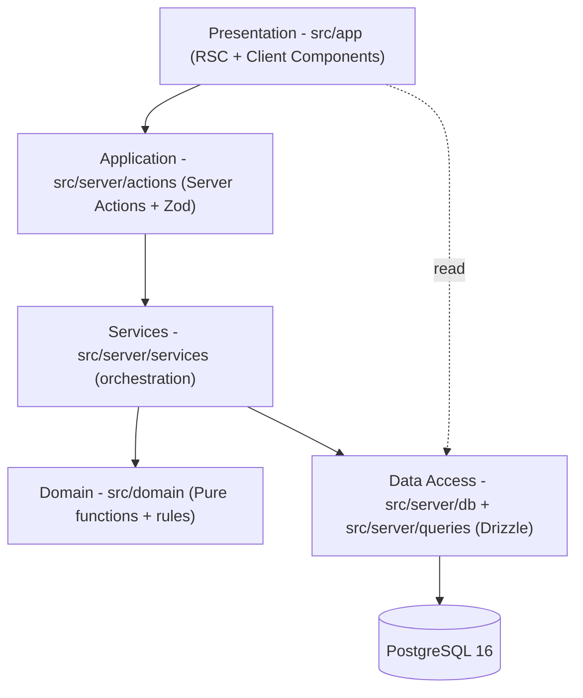
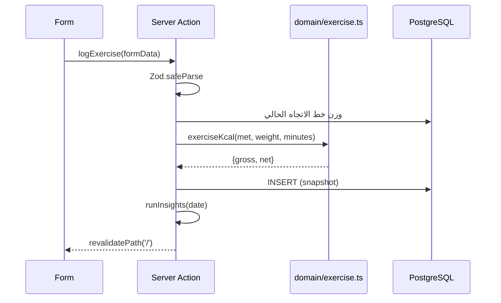

# AS_FIT — الهندسة المعمارية

## 1. الطبقات



## 2. قواعد الاستيراد (Hard Rules)

1. `src/domain/**` **لا يستورد** من `src/server/**` أو `next/*` أو `drizzle-orm` أو أي IO. رياضيات خالصة + أنواع.
2. `src/app/**` لا يكتب لقاعدة البيانات مباشرة؛ الكتابة عبر `src/server/actions/**` فقط. القراءة مسموحة عبر `src/server/queries/**`.
3. كل Server Action يبدأ بـ `'use server'` ويتحقق بـ Zod قبل أي منطق.
4. المنطق المشترك بين عدة Actions يوضع في `src/server/services/**`.
5. مخططات Zod في `src/lib/validation/**` وتُستخدم في النموذج والـ Action معاً.
6. Alias الاستيراد: `@/` → `src/`.

## 3. هيكل المجلدات

```
AS_FIT/
├─ docker-compose.yml, Dockerfile, .env.example, drizzle.config.ts, postcss.config.mjs, package.json
├─ scripts/ (backup.ps1, restore.ps1)
├─ drizzle/                         # migrations مولدة
├─ src/
│  ├─ app/
│  │  ├─ layout.tsx                 # dir="rtl", fonts, theme
│  │  ├─ page.tsx                   # Dashboard
│  │  ├─ log/{meals,beverages,activity,screen,sleep}/page.tsx
│  │  ├─ weigh-in/ measurements/ trends/ insights/ foods/ settings/
│  ├─ components/
│  ├─ styles/globals.css            # Tailwind v4 + @theme tokens
│  ├─ domain/                       # ⚠ Pure only
│  │  ├─ constants.ts age.ts metabolism.ts exercise.ts nutrition.ts
│  │  ├─ beverages.ts caffeine-kinetics.ts anthropometry.ts sleep.ts weight-trend.ts
│  │  └─ insights/ (types.ts, engine.ts, rules/*.ts)
│  ├─ server/
│  │  ├─ db/ (client.ts, schema.ts, seed.ts)
│  │  ├─ queries/
│  │  ├─ services/ (daily-summary.ts, insights-runner.ts)
│  │  └─ actions/ (meals, beverages, exercise, screen, sleep, weigh-in, measurements, profile)
│  └─ lib/ (validation/, time.ts, cn.ts)
└─ tests/ (domain/, e2e/)
```

## 4. تدفق كتابة نموذجي (تسجيل تمرين)



## 5. التحقق

- ابحث عن أي استيراد مخالف: `grep -r "from '@/server\|from 'next\|drizzle" src/domain` يجب أن يُرجع لا شيء.
- `pnpm tsc --noEmit` بلا أخطاء.
