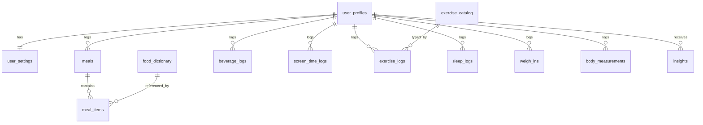

# AS_FIT — قاعدة البيانات

## 1. المراجع

- الـ DDL الكامل (المرجع الدلالي): [schema.sql](./references/schema.sql)
- بيانات الـ Seed: [seed-data.md](./references/seed-data.md)

التنفيذ الفعلي في `src/server/db/schema.ts` بـ Drizzle، ويجب أن يطابق `schema.sql`.

## 2. مخطط العلاقات



## 3. الجداول باختصار

| الجدول | التردد | ملاحظات |
|---|---|---|
| `user_profiles` | مرة | الجنس، تاريخ الميلاد، الطول، الوزن الأولي/المستهدف، معامل النشاط (1.2) |
| `user_settings` | مرة | المنطقة الزمنية، العجز المخطط، g/kg بروتين، `use_net_met`، ثوابت الكافيين، ساعات الصيام، 7700، α |
| `food_dictionary` | مرجعي | `nutrition_basis` + `grams_per_unit` |
| `meals` | يومي (N) | `time_drift_minutes` مولّد |
| `meal_items` | لكل وجبة (N) | سعرات/بروتين **Snapshot** |
| `beverage_logs` | يومي (N) | `caffeine_mg`، `milk_calories`، `milk_protein_g`، `sugar_calories` Snapshot؛ `total_calories` مولّد |
| `day_status` | يومي (1) | PK `(user_id, log_date)`؛ `intake_complete` — فقط الأيام المكتملة تدخل حسابات العجز والـ TDEE المرصود |
| `screen_time_logs` | يومي (1) | `UNIQUE(user_id, log_date)`، مجموع ≤ 24 |
| `exercise_catalog` | مرجعي | MET افتراضي |
| `exercise_logs` | يومي (N) | `weight_used_kg`، gross/net Snapshot |
| `sleep_logs` | يومي (1) | `log_date` = تاريخ الاستيقاظ؛ TIB/Latency/TST مولّدة |
| `weigh_ins` | أسبوعي (+يومي اختياري) | `fasting_hours` مولّد، `is_protocol_compliant` |
| `body_measurements` | شهري | `whr` مولّد، `neck_cm` لنسبة الدهون |
| `insights` | آلي | `UNIQUE(user_id, rule_code, period_start, period_end)` |
| `v_daily_intake` | View | تجميع الطعام + المشروبات + التمارين لكل يوم + `total_protein_g` + `intake_complete` |

## 4. قرارات تصميم ملزمة

1. **`user_id` في كل جدول** حتى مع مستخدم واحد.
2. **فصل** الوجبات عن أصنافها، والشاشات عن التمارين، والوزن عن المحيطات.
3. **Snapshot:** لا تُعِد حساب سعرات الوجبات القديمة عند تعديل القاموس.
4. **الزمن:** `TIMESTAMPTZ` للأحداث، `DATE` لليوم المحلي حسب `user_settings.timezone`.
5. **الأعمدة المولدة** للحسابات الحتمية فقط (فرق أوقات، مجاميع، نسب). TDEE والعجز **لا** يُحسبان في SQL (يعتمدان على العمر والإعدادات) — انظر `asfit-server-actions`.
6. `time_drift_minutes`: موجب = تأخير. عبور منتصف الليل يُعالج **داخل التعبير المولّد** بلفّ الفرق إلى `[-720, 720)`: `((d + 720) % 1440 + 1440) % 1440 − 720` (لا يمكن تصحيح عمود مولّد من الكود).
7. القيود `CHECK` على النطاقات (الطول 100–250، الوزن 30–300، الانتعاش 1–5...).
8. فهارس `(user_id, log_date)` على جداول السجلات.

## 5. ملاحظات Drizzle

- الأعمدة المولدة: `.generatedAlwaysAs(sql\`...\`)`.
- ENUMs: `pgEnum('meal_type_t', [...])`.
- `NUMERIC` يعود كـ `string` في Drizzle — حوّل بـ `Number()` قبل تمريره لـ `src/domain`.
- الـ View تُنشأ بـ migration SQL مخصص (`drizzle-kit generate --custom`).

## 6. التحقق

```powershell
pnpm db:generate; pnpm db:migrate; pnpm db:seed
docker exec asfit-db psql -U asfit -d asfit -c "\dt"
docker exec asfit-db psql -U asfit -d asfit -c "SELECT * FROM v_daily_intake LIMIT 5;"
```
