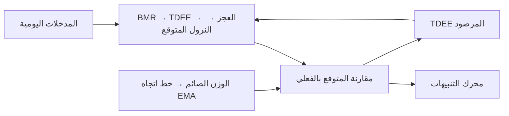

# AS_FIT — المنصة والمكدس التقني

## 1. ما هو النظام؟

**ليس حاسبة سعرات**، بل **نظام تحكم ذو تغذية راجعة (Closed-Loop Feedback Control)** يعامل الجسم كنظام ديناميكي:

- **المدخلات:** الطعام، المشروبات والكافيين، توقيت الوجبات (Chrono-Nutrition)، التمارين، الحمل الذهني للشاشات، النوم.
- **النموذج:** BMR / TDEE / MET لتقدير الحرق.
- **المخرجات المقاسة:** الوزن الصائم المعياري، المحيطات الشهرية.
- **الحلقة:** مقارنة النزول المتوقع بالفعلي ← معايرة TDEE ← تنبيهات ذكية.

## 2. المبادئ الحاكمة (إلزامية)

| المبدأ | التطبيق |
|---|---|
| Local-first & Privacy | لا خدمات سحابية؛ كل البيانات في PostgreSQL داخل Docker volume. |
| Pure Domain Logic | المعادلات دوال نقية في `src/domain/` بلا IO. |
| Snapshot over Recompute | القيم المحسوبة لحظة التسجيل تُخزَّن ولا تتغير بتعديل القاموس. |
| Derived via DB | الحقول المشتقة البسيطة = `GENERATED ALWAYS AS ... STORED`. |
| Explainable Insights | كل تنبيه يحمل `payload` بالأرقام المسببة. |
| Noise-aware | الوزن يُفسَّر عبر خط اتجاه + أعلام ضوضاء، لا قراءة مفردة. |

## 3. المكدس التقني المعتمد

| الطبقة | التقنية |
|---|---|
| Runtime | Node.js 24 LTS |
| Framework | Next.js 16 (App Router, RSC, Server Actions) — Monolith |
| اللغة | TypeScript 5 (`strict: true`) |
| DB | PostgreSQL 16 (`postgres:16-alpine`) |
| ORM / Migrations | Drizzle ORM + drizzle-kit |
| Validation | Zod |
| Forms | React Hook Form + `@hookform/resolvers/zod` |
| Charts | Recharts |
| Dates | date-fns + date-fns-tz |
| Styling | Tailwind CSS v4 (`@tailwindcss/postcss`) + Tokens في `@theme`، RTL، Light & Green |
| Fonts | Cairo (نصوص) + JetBrains Mono (أرقام) عبر `next/font` |
| Tests | Vitest (وحدات) + Playwright (E2E) |
| Package manager | pnpm 10 (`packageManager: pnpm@10.34.6`) |
| Containers | Docker Compose v2 |

> لا تُضف مكتبات خارج هذا الجدول دون موافقة المستخدم. لا CSS Modules ولا مكتبات مكونات UI جاهزة.

## 4. فهرس المهارات

| المهمة | المهارة |
|---|---|
| الطبقات، هيكل المجلدات، قواعد الاستيراد | `asfit-architecture` |
| الجداول، ENUMs، الـ Views، الـ Seed | `asfit-database` |
| BMR، TDEE، MET، الكافيين، WHR، النوم، EMA | `asfit-metabolic-science` |
| شاشة ومنطق الوزن الأسبوعي | `asfit-weigh-in-protocol` |
| قواعد التنبيهات الذكية | `asfit-insights-engine` |
| Server Actions وخدمة الملخص اليومي | `asfit-server-actions` |
| الصفحات والهوية البصرية | `asfit-ui-design` |
| Docker، env، السكربتات، النسخ الاحتياطي | `asfit-local-devops` |
| الاختبارات و Golden Values ومعايير القبول | `asfit-testing-qa` |

المرجع البشري الكامل: [SRS_Metabolic_Telemetry.md](../../../docs/SRS_Metabolic_Telemetry.md).

## 5. خطة التنفيذ (Roadmap)

| المرحلة | المخرجات | المهارات |
|---|---|---|
| P0 الأساس | Next.js + TS + Docker Postgres + Drizzle schema + migrations + seed + Tokens + Layout RTL | devops, database, architecture, ui-design |
| P1 المحرك العلمي | كل `src/domain/*` + اختبارات Golden Values | metabolic-science, testing-qa |
| P2 الإدخال اليومي | الملف، القاموس، الوجبات، المشروبات، التمارين، الشاشات، النوم | server-actions, ui-design |
| P3 القياس | Wizard الوزن، القياسات الشهرية، EMA | weigh-in-protocol |
| P4 الملخص والاتجاهات | Dashboard + `/trends` + TDEE المرصود | server-actions, metabolic-science |
| P5 الذكاء | Insights Engine + 8 قواعد | insights-engine |
| P6 الصقل | E2E، النسخ الاحتياطي، تصدير CSV | testing-qa, devops |

**خارج النطاق حالياً:** PWA، استيراد بيانات الساعة الذكية، الباركود، قوالب الوجبات.

## 6. تنبيه

النظام أداة تتبع شخصية وليس جهازاً طبياً. لا تُصاغ رسائل الواجهة كتشخيص طبي.
