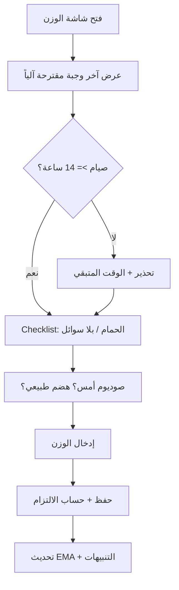

# AS_FIT — بروتوكول الوزن المعياري

## 1. الشروط (Gate Checks)

| # | الشرط | التحقق |
|---|---|---|
| 1 | صيام ≥ `required_fasting_hours` (14) | `measured_at − last_meal_at`. يُقترح `last_meal_at` آلياً من آخر `meals.actual_time` لليوم السابق. |
| 2 | بعد دخول الحمام | Checkbox إلزامي `bathroom_done` |
| 3 | قبل أي ماء/قهوة | Checkbox `no_fluids_before` + لا يوجد `beverage_logs` في نفس اليوم قبل `measured_at` |
| 4 | مؤشرات الضوضاء | `high_sodium_yesterday`, `normal_digestion` — الإجابة إلزامية |
| 5 | نفس الميزان/المكان، ملابس خفيفة | نص إرشادي |

## 2. التحقق والالتزام

```ts
// src/lib/validation/weigh-in.ts
import { z } from 'zod';

export const weighInSchema = z.object({
  measuredAt: z.coerce.date(),
  lastMealAt: z.coerce.date(),
  weightKg: z.coerce.number().min(30).max(300),
  bathroomDone: z.boolean(),
  noFluidsBefore: z.boolean(),
  highSodiumYesterday: z.boolean(),
  normalDigestion: z.boolean(),
  isOfficialWeekly: z.boolean().default(true),
});

export function protocolCompliance(input: z.infer<typeof weighInSchema>, requiredFastingH = 14) {
  const fastingH = (input.measuredAt.getTime() - input.lastMealAt.getTime()) / 3.6e6;
  const violations: string[] = [];
  if (fastingH < requiredFastingH) violations.push(`مدة الصيام ${fastingH.toFixed(1)} ساعة < ${requiredFastingH}`);
  if (!input.bathroomDone) violations.push('لم يتم دخول الحمام قبل القياس');
  if (!input.noFluidsBefore) violations.push('تم تناول سوائل قبل القياس');
  return { compliant: violations.length === 0, fastingH, violations };
}
```

## 3. قواعد المعالجة

- القراءة غير الملتزمة **تُحفظ ولا تُرفض**، مع `is_protocol_compliant = false`.
- تظهر بتمييز بصري في الرسوم، **ولا تدخل** في EMA الرسمي ولا في الـ TDEE المرصود.
- `is_official_weekly = false` للأوزان اليومية الاختيارية. كل القراءات الملتزمة (يومية وأسبوعية) تغذي EMA **الزمني** (α=0.10 لكل يوم، `α_eff = 1 − 0.9^Δأيام`) وميل OLS للـ TDEE المرصود.
- قيد `UNIQUE(user_id, log_date)`: قراءة واحدة يومياً؛ إعادة الإدخال = تحديث مع تأكيد.
- بعد الحفظ: تحديث خط الاتجاه ثم `runInsights` على نافذة 7–21 يوماً (لقاعدتي `FALSE_PLATEAU` و `TRUE_PLATEAU`).

## 4. تدفق الواجهة (Wizard من 4 خطوات)



## 5. التحقق

- اختبار: صيام 12 ساعة ← `compliant=false` مع رسالة الصيام.
- اختبار: كل الشروط محققة ← `compliant=true`, `violations=[]`.
