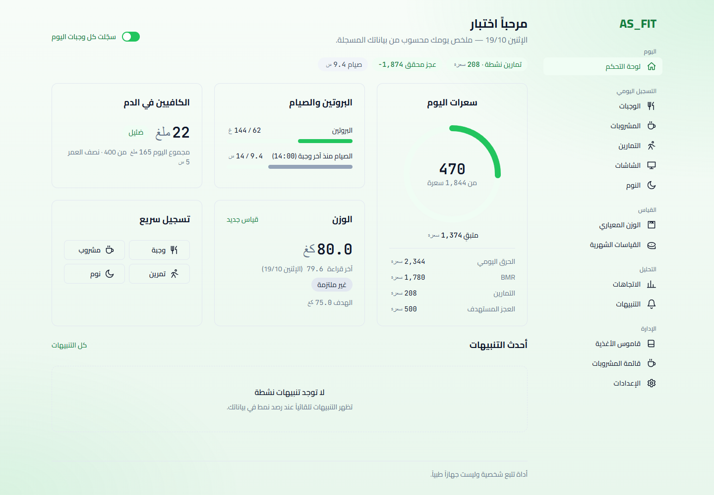
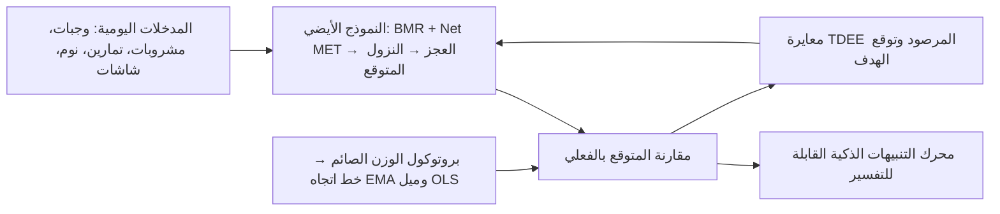

<div dir="rtl" align="right">

# AS_FIT — نظام القياس الأيضي الشخصي ذو التغذية الراجعة

**[📖 English Documentation (README.md)](./README.md)** · **[دليل المساهمة](./CONTRIBUTING.ar.md)** · **[قضايا جاهزة للمساهمين](./docs/GOOD_FIRST_ISSUES.md)** · **[المعمارية](./docs/ARCHITECTURE.md)** · **[نظام التصميم](./docs/DESIGN_SYSTEM.md)** · **[النموذج العلمي](./docs/SCIENTIFIC_MODEL.md)** · **[خارطة الطريق](./ROADMAP.md)**

[](https://github.com/salims0110/as_fit/actions/workflows/ci.yml)
[](./LICENSE)
[](./CONTRIBUTING.ar.md)
[](https://nextjs.org/)
[](https://www.postgresql.org/)

---

**AS_FIT** ليس حاسبة سعرات تقليدية، بل **نظام تحكم ذو تغذية راجعة مغلقة (Closed-Loop Metabolic Telemetry)** مفتوح المصدر ويعمل محلياً بالكامل (`Local-First`) دون أي سحابة خارجية. يعامل النظام الجسم كنظام ديناميكي قابل للقياس والمعايرة المستمرة بدلاً من الاعتماد الأعمى على المعادلات النظرية الثابتة.



## لماذا AS_FIT مختلف؟

1. **حلقة تغذية راجعة حقيقية (`Observed TDEE` & `Goal Projection`):** يجمع بين معادلة `Mifflin-St Jeor` ومعادلة `Katch-McArdle` الاختيارية (عند توفر نسبة الدهون)، وبعد 14 يوماً من القراءات الملتزمة يحسب حرقك الفعلي عبر الانحدار الخطي (`OLS`) ويمزجه تدريجياً لتجاوز التكيّف الأيضي، مع توقع المدة المتبقية للوصول إلى الوزن المستهدف بناءً على وتيرتك الفعلية.
2. **وعي بالضوضاء الفيزيولوجية (`Noise-Aware Weighing`):** يفصل بين فقدان الدهون واحتباس السوائل عبر بروتوكول وزن معياري (صيام 14 ساعة، أعلام الصوديوم والهضم) وخط اتجاه أسي مرتبط بالزمن (`Time-Weighted EMA`).
3. **التوقيت الحيوي وحركية الكافيين (`Chrono-Nutrition & Caffeine Kinetics`):** يقيس انحراف مواعيد الوجبات (`Time Drift`) حتى عبر منتصف الليل، ويحسب الكافيين المتبقي في الدم لحظياً ووقت النوم بنموذج نصف العمر (`T½`) مع اقتراح آخر موعد آمن للقهوة، ويقيس اضطراب منتصف النوم بالمتوسط الدائري (`Circular Mean`).
4. **محرك تنبيهات قابل للتفسير (`Explainable Insights`):** 8 قواعد ذكية تكتشف الثبات الكاذب والحقيقي، العجز المفرط، نقص البروتين، والحمل الذهني، مع إرفاق الأرقام المسببة لكل تنبيه (`payload`).
5. **خصوصية مطلقة وبيانات ملك للمستخدم:** كل بياناتك تسكن قاعدة `PostgreSQL 16` محلية مع ترويسات حماية HTTP صارمة، ويبدأ قاموس الأغذية والمشروبات نظيفاً لتبنيه وفق عاداتك الفعلية، مع حفظ السجلات التاريخية بنمط اللقطة الثابتة (`Snapshot over Recompute`).



---

## البدء السريع (Quick Start)

### الخيار 1: معاينة فورية بدون قاعدة بيانات (خلال 30 ثانية)
مثالي لاستكشاف الواجهة أو المساهمة في التصميم والمكونات عبر 90 يوماً من بيانات المحاكاة الحتمية:

```bash
git clone https://github.com/salims0110/as_fit.git
cd as_fit
pnpm install
USE_MOCK_DATA=true pnpm dev
```
> على Windows PowerShell: `$env:USE_MOCK_DATA="true"; pnpm dev` ثم افتح `http://localhost:3000`.

### الخيار 2: التشغيل الكامل عبر Docker Compose (للاستخدام الشخصي اليومي)
يشغّل قاعدة البيانات `PostgreSQL 16`، يطبّق الترحيلات والبيانات الأولية تلقائياً، ثم يطلق الخادم المستقل:

```bash
cp .env.example .env
docker compose up -d --build
```
افتح المتصفح على `http://127.0.0.1:3000`.

### الخيار 3: بيئة التطوير المحلية (Local Development)

```bash
cp .env.example .env
pnpm install
pnpm db:up
pnpm db:migrate
pnpm db:seed
pnpm dev
```

---

## خريطة الصفحات والميزات

| المسار | الوظيفة |
|---|---|
| `/` | **لوحة التحكم:** حلقة السعرات، شريطا البروتين والصيام، الكافيين الحالي في الدم، اتجاه الوزن وتوقع الوصول للهدف، وأحدث التنبيهات |
| `/log/meals` | **الوجبات:** تسجيل الأصناف مع حساب الانحراف الزمني (`Time Drift`) وإضافة سريعة للقاموس مباشرة |
| `/log/beverages` | **المشروبات:** حساب الكافيين بالملليغرام أو بوزن البن الجاف، مع حساب سعرات وبروتين الحليب والسكر آلياً |
| `/log/activity` | **التمارين:** كتالوج أنشطة قياسي بمرجع `Compendium MET` مع حساب الحرق الصافي (`Net MET`) والإجمالي |
| `/log/sleep` | **النوم:** حساب الوقت في السرير، كمون النوم، الاستيقاظ الليلي (`WASO`)، وكفاءة النوم |
| `/log/screen` | **الشاشات:** تتبع الحمل الذهني العالي والمتوسط والترفيهي كإشارة سلوكية |
| `/weigh-in` | **الوزن المعياري:** معالج من 4 خطوات للتحقق من شروط الصيام وتسجيل مؤشرات احتباس السوائل |
| `/measurements` | **القياسات الشهرية:** حساب `WHR` و`WHtR` ونسبة الدهون بطريقة `US Navy` |
| `/trends` | **الاتجاهات:** رسوم بيانية للوزن الخام مقابل `EMA`، العجز التراكمي، والحرق النظري مقابل المرصود |
| `/insights` | **التنبيهات الذكية:** استعراض الاستنتاجات الآلية مع الأرقام المسببة وإمكانية التجاهل |
| `/foods` و `/drinks` | **القواميس الشخصية:** إدارة الأغذية والمشروبات الخاصة بالمستخدم |
| `/settings` | **الإعدادات:** الملف الشخصي، جدول الوجبات، الأهداف، خيار `Katch-McArdle BMR`، والثوابت العلمية |

---

## التوثيق الهندسي والمساهمة المجتمعية

- **[دليل المساهمة بالعربية (CONTRIBUTING.ar.md)](./CONTRIBUTING.ar.md)** و**[بالإنجليزية (CONTRIBUTING.md)](./CONTRIBUTING.md)**: شرح المسارات الستة للمساهمة ودورة حياة حل القضايا.
- **[بنك القضايا الجاهزة للمساهمين (GOOD_FIRST_ISSUES.md)](./docs/GOOD_FIRST_ISSUES.md)**: 8 قضايا جاهزة للتبني الفوري من المبتدئ حتى المتقدم.
- **[المعمارية (ARCHITECTURE.md)](./docs/ARCHITECTURE.md)** · **[نظام التصميم (DESIGN_SYSTEM.md)](./docs/DESIGN_SYSTEM.md)** · **[النموذج العلمي (SCIENTIFIC_MODEL.md)](./docs/SCIENTIFIC_MODEL.md)**.

## إخلاء مسؤولية طبي والترخيص

> [!CAUTION]
> **AS_FIT** أداة تتبع وقياس شخصية وتعليمية **وليست جهازاً طبياً** ولا تغني عن استشارة الطبيب أو أخصائي التغذية المعتمد. راجع [SECURITY.md](./SECURITY.md).

مرخّص بموجب رخصة **[MIT](./LICENSE)** — Copyright (c) 2026 Salim Salih & Contributors.

</div>
