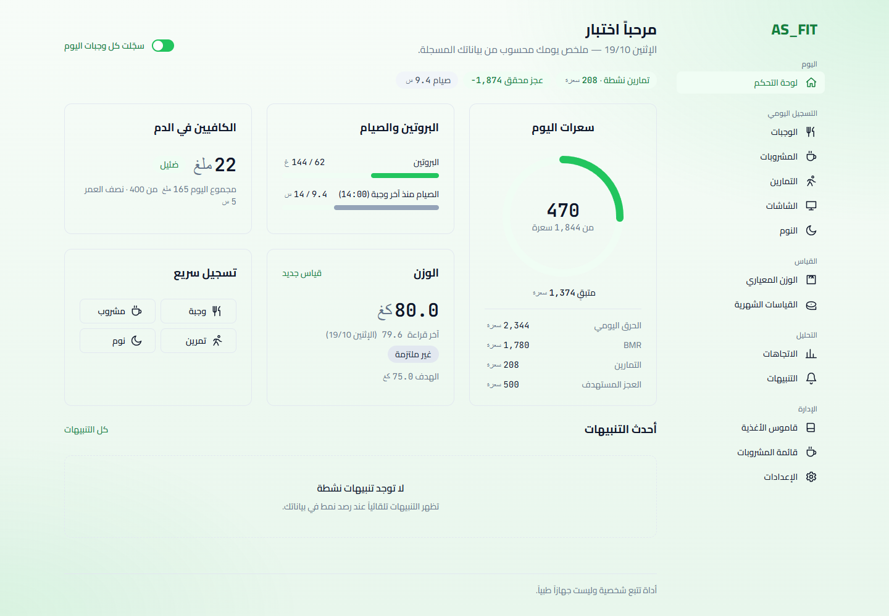
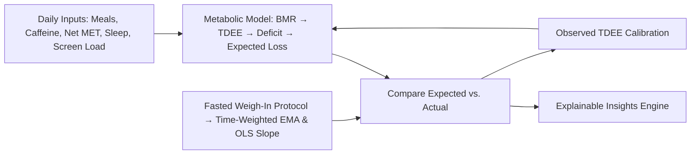

# AS_FIT — Personal Metabolic Telemetry & Closed-Loop Control System

**[📖 الوثيقة العربية الكاملة (README.ar.md)](./README.ar.md)** · **[Contributing](./CONTRIBUTING.md)** · **[دليل المساهمة](./CONTRIBUTING.ar.md)** · **[Starter Issues](./docs/GOOD_FIRST_ISSUES.md)** · **[Architecture](./docs/ARCHITECTURE.md)** · **[Design System](./docs/DESIGN_SYSTEM.md)** · **[Scientific Model](./docs/SCIENTIFIC_MODEL.md)** · **[Roadmap](./ROADMAP.md)**

[](https://github.com/salims0110/as_fit/actions/workflows/ci.yml)
[](./LICENSE)
[](./CONTRIBUTING.md)
[](https://nextjs.org/)
[](https://www.postgresql.org/)

**AS_FIT** is a **local-first**, privacy-respecting **Personal Metabolic Telemetry & Closed-Loop Feedback Control System** built with an Arabic-first (`RTL`) interface on Next.js 16 (App Router), TypeScript, Drizzle ORM, and PostgreSQL 16.

Rather than acting as a static calorie counter, AS_FIT models the human body as a dynamic feedback system—combining nutrition, meal timing (*chrono-nutrition*), caffeine pharmacokinetics, net MET-based activity, sleep metrics, and cognitive screen load against a standardized fasted weigh-in protocol, time-weighted EMA trend, and Ordinary Least Squares (`OLS`) **Observed TDEE** calibration.



---

## ✨ Key Features

- **Closed-Loop Metabolic Modeling (`src/domain/`)**: Pure, zero-IO domain functions for BMR (*Mifflin-St Jeor* + optional *Katch-McArdle* when body fat is known), dynamic Net/Gross MET TDEE, OLS Observed TDEE recalibration, time-weighted EMA trend, and pace-based target weight projection.
- **Chrono-Nutrition & Caffeine Kinetics**: Tracks meal timing drift relative to custom meal schedules (wrapping cleanly across midnight) and models first-order caffeine half-life (`T½`) impact on sleep readiness, including latest safe dose timing.
- **Standardized Weigh-In Protocol**: 4-step fasted weigh-in wizard with protocol gate checks (14h fast, voiding, pre-fluid) and physiological noise flags (sodium, digestion, sleep) so water-weight spikes aren't misread as stalls.
- **Explainable Insights Engine**: 8 deterministic rules (`LUNCH_DRIFT`, `COGNITIVE_LOAD`, `FALSE_PLATEAU`, `TRUE_PLATEAU`, `BEDTIME_CAFFEINE`, `LATE_EATING`, `PROTEIN_SHORT`, `AGGRESSIVE_DEFICIT`) that attach transparent numerical payloads explaining why each insight triggered.
- **User-Defined Catalogs & Snapshot Integrity**: Custom food and beverage catalogs start empty for user ownership; calculated nutritional and metabolic values are snapshotted at log time so historical entries never drift when catalogs are edited.
- **Calm Fitness Telemetry UI (`Light & Green`)**: Semantic Tailwind CSS v4 `@theme` tokens (strictly greens + calm slates—zero harsh reds/oranges/yellows), logical RTL layout, `Cairo` for Arabic prose, and `JetBrains Mono` for tabular numbers.
- **100% Local-First & Zero Cloud Lock-in**: Runs completely locally via Docker Compose + PostgreSQL with hardened HTTP security headers, or instantly in read-only preview mode via `USE_MOCK_DATA=true`.



---

## 🛠️ Tech Stack

| Layer | Technology |
|---|---|
| **Framework & Runtime** | Next.js 16.4 (App Router, RSC, Server Actions), React 19.3, Node.js `>= 22` |
| **Language & Validation** | TypeScript 5.9 (`strict: true`), Zod 4, React Hook Form |
| **Styling & Charts** | Tailwind CSS v4 (`@theme` semantic tokens, logical RTL), Recharts |
| **Database & ORM** | PostgreSQL 16, Drizzle ORM & Drizzle Kit |
| **Testing & QA** | Vitest + `fast-check` property tests (`>= 95%` domain coverage), Playwright E2E, ESLint |
| **Containerization** | Docker & Docker Compose (`db`, one-shot `migrate`, non-root standalone `app`) |

---

## 🚀 Quick Start

### Prerequisites

- **Node.js** `>= 22` and **pnpm** (`10.x`)
- **Docker** & **Docker Compose** (optional if using Mock Mode)

### Option A: Instant Preview with Mock Data (30 Seconds, No Database Needed)

```bash
git clone https://github.com/salims0110/as_fit.git
cd as_fit
pnpm install
cp .env.example .env
```
Set `USE_MOCK_DATA=true` in `.env` (or run `USE_MOCK_DATA=true pnpm dev`), then open [http://localhost:3000](http://localhost:3000) to explore 90 days of deterministic synthetic data.

### Option B: Local Development with PostgreSQL

```bash
cp .env.example .env      # keep USE_MOCK_DATA=false
pnpm install
pnpm db:up
pnpm db:migrate
pnpm db:seed
pnpm dev
```

### Option C: Full Self-Hosted Stack with Docker Compose

```bash
cp .env.example .env
docker compose up -d --build
```
Starts `db` (PostgreSQL 16), runs the one-shot `migrate` service (migrations + idempotent seed), and serves the hardened standalone Next.js app on `http://127.0.0.1:3000`.

---

## 📚 Documentation & Architecture

| Document | Contents |
|---|---|
| **[README.ar.md](./README.ar.md)** | الواجهة التعريفية الكاملة باللغة العربية |
| **[CONTRIBUTING.md](./CONTRIBUTING.md)** / **[CONTRIBUTING.ar.md](./CONTRIBUTING.ar.md)** | Contribution tracks, Issue-to-PR workflow, and non-negotiable architectural & UI rules |
| **[docs/GOOD_FIRST_ISSUES.md](./docs/GOOD_FIRST_ISSUES.md)** | Curated, well-scoped starter, intermediate, and deep-dive issues for contributors |
| **[docs/ARCHITECTURE.md](./docs/ARCHITECTURE.md)** | Layered architecture, import boundaries, Snapshot semantics, and Mock Mode design |
| **[docs/DESIGN_SYSTEM.md](./docs/DESIGN_SYSTEM.md)** | `Light & Green` token specification, RTL logical utilities, and Arabic unit rules |
| **[docs/SCIENTIFIC_MODEL.md](./docs/SCIENTIFIC_MODEL.md)** | Equations, Insights Engine guide, Golden Values table, and peer-reviewed citations |
| **[docs/SRS_Metabolic_Telemetry.md](./docs/SRS_Metabolic_Telemetry.md)** | Full Software Requirements & Architecture Specification (SRS + SAD) |
| **[ROADMAP.md](./ROADMAP.md)** & **[SECURITY.md](./SECURITY.md)** | Project roadmap, explicit non-goals, security policy, and medical disclaimer |

---

## 🧪 Available Scripts

| Command | Description |
|---|---|
| `pnpm dev` | Start Next.js development server |
| `pnpm build` | Build production application |
| `pnpm check` | **Full pre-PR gate**: `lint` + `typecheck` + `check:conventions` + `test` |
| `pnpm check:conventions` | Verify zero raw colors, logical RTL classes only, and strict layer boundaries |
| `pnpm typecheck` | Run TypeScript type checking (`tsc --noEmit`) |
| `pnpm lint` | Run ESLint across the repository |
| `pnpm test` | Run Vitest unit, Golden Values & `fast-check` property tests |
| `pnpm test:coverage` | Run Vitest with V8 coverage (`src/domain/**` >= 95% threshold) |
| `pnpm test:e2e` | Build and run Playwright end-to-end tests against isolated `asfit_test` DB |
| `pnpm db:up` / `pnpm db:down` | Start / stop local PostgreSQL container |
| `pnpm db:migrate` / `pnpm db:seed` | Apply Drizzle migrations / run idempotent seed |
| `pnpm db:backup` | Create a timestamped PostgreSQL custom-format dump in `backups/` (Linux / macOS / Windows) |
| `pnpm db:restore <file>` | Restore database from a dump file with interactive confirmation (`--yes` to skip prompt) |

---

## 🤝 Contributing

Contributions are welcome across **6 clear tracks**: Domain Science & Insights, RTL UI/UX & Accessibility, Backend/Database Features, Testing & QA, Cross-Platform DevOps, and Documentation!

1. Browse **[docs/GOOD_FIRST_ISSUES.md](./docs/GOOD_FIRST_ISSUES.md)** or open issues labeled `good first issue` / `status:help-wanted`.
2. Read **[CONTRIBUTING.md](./CONTRIBUTING.md)** (or **[CONTRIBUTING.ar.md](./CONTRIBUTING.ar.md)**) and run `pnpm check` before opening a PR.
3. All participants agree to follow our **[Code of Conduct](./CODE_OF_CONDUCT.md)**.

---

## ⚠️ Medical Disclaimer & License

> [!CAUTION]
> **AS_FIT** is a personal educational tracking tool and **not a medical device**. It does not provide medical diagnosis or treatment advice. Consult a qualified physician or registered dietitian before adopting significant caloric deficits or if you have underlying health conditions. See [SECURITY.md](./SECURITY.md).

Licensed under the **[MIT License](./LICENSE)** — Copyright (c) 2026 Salim Salih & Contributors.
