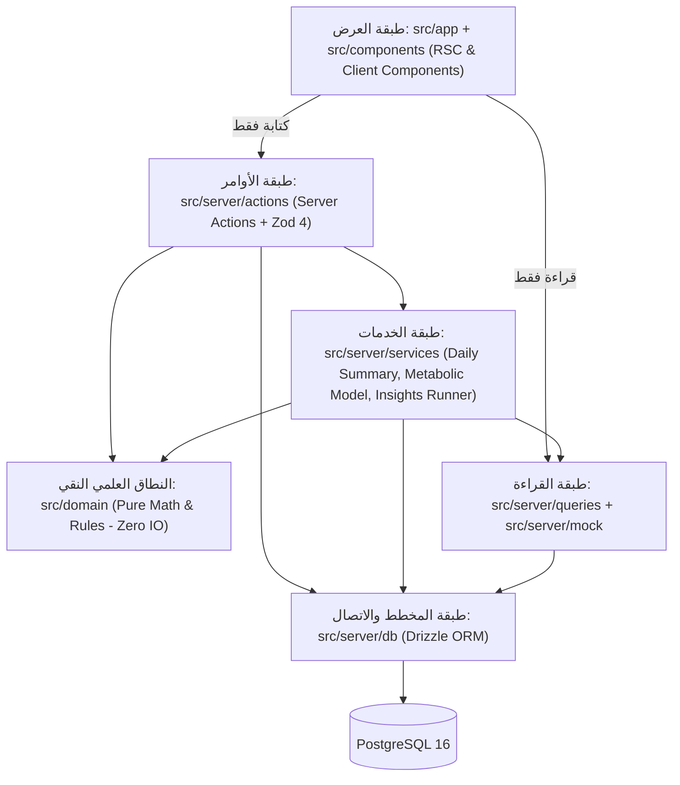

# الهندسة المعمارية لمشروع AS_FIT (Architecture Guide)

يتبع **AS_FIT** نمط **Next.js Full-Stack Monolith** مقسّم إلى طبقات صارمة تضمن الفصل التام بين **العلم الرياضي النقي (`Domain`)** و**منطق التنسيق والوصول للبيانات (`Server`)** و**طبقة العرض (`Presentation`)**.

---

## 1. مخطط الطبقات وتدفق الاعتماديات

---

## 2. قواعد الاستيراد والفصل المعماري (`Hard Boundaries`)

| القاعدة | التفاصيل | طريقة التحقق |
|---|---|---|
| **1. نقاء `src/domain/**`** | لا يستورد إطلاقاً من `@/server/*` أو `next/*` أو `drizzle-orm` أو `postgres` أو أي مكتبة `IO`، مع اشتراط تغطية اختبارات `>= 95%`. | مفروضة آلياً في [eslint.config.mjs](../eslint.config.mjs)، `vitest.config.mts`، و`pnpm check` |
| **2. منع الاتصال المباشر من الواجهة** | لا يستورد `src/app/**` ولا `src/components/**` كائن الاتصال `db` أو `drizzle-orm`. كل قراءة تمر عبر `src/server/queries/**` وكل كتابة تمر عبر `src/server/actions/**`. | مفروضة آلياً عبر `scripts/verify-conventions.ts` |
| **3. التحقق الموحّد بـ Zod 4** | تعيش مخططات التحقق الصارمة (التواريخ الحقيقية، المناطق الزمنية المعتمدة، ومعرّفات السجلات) في `src/lib/validation/` وتُشارك بين نماذج العميل وبداية كل `Server Action`. | اختبارات `tests/validation/*` |
| **4. ترويسات الحماية** | يطبّق [next.config.ts](../next.config.ts) سياسة `CSP` و`X-Frame-Options` و`Referrer-Policy: no-referrer` على كل المسارات. | اختبارات `tests/config/security-headers.test.ts` |

---

## 3. المبادئ الهندسية الجوهرية

### أ) اللقطة فوق إعادة الحساب (`Snapshot over Recompute`)
عند تسجيل وجبة أو مشروب أو تمرين، يحسب الـ `Server Action` القيم الغذائية أو الحرق عبر `src/domain/` ويخزّن الناتج مباشرة في أعمدة السجل (`calculated_calories`، `caffeine_mg`، `net_burned_kcal`، `weight_used_kg`). تعديل القاموس لاحقاً لا يمس السجلات التاريخية أبداً.

### ب) اكتمال اليوم (`day_status.intake_complete`)
اليوم غير المعلّم كمكتمل التسجيل **لا يدخل** في حسابات العجز التراكمي، ولا النزول المتوقع، ولا معايرة `Observed TDEE`، ولا قواعد الثبات (`FALSE_PLATEAU` / `TRUE_PLATEAU`).

### ج) معمارية وضع المحاكاة (`USE_MOCK_DATA`)
عند تفعيل `MOCK_MODE` في [src/server/mock/mode.ts](../src/server/mock/mode.ts)، تقرأ دوال `src/server/queries/*` من بيانات حتمية لـ 90 يوماً في `src/server/mock/mock-data.ts` محسوبَة بنفس دوال `src/domain/`، وترفض الـ `Server Actions` أي كتابة. عند إضافة استعلام قراءة جديد، احرص دائماً على دعم `MOCK_MODE`.

